원본은 `CellFactory_pack.unitypackage`의 `Assets/Scripts/Factory/` 스크립트입니다. 파일 경로는 이 폴더 기준입니다.

구분 기준

- **reuse (그대로)**: 원본을 수정 없이 씀
- **adapt (변형)**: 원본을 SRS에 맞게 줄이거나 고쳐 씀
- **new (새로)**: 원본에 대응하는 클래스가 없음

| 우리 프로젝트 | 구분 | CellFactory 원본 클래스 | 원본 파일 | 처리 |
| --- | --- | --- | --- | --- |
| `ProcessController` | adapt | `CellController` | `Cell/CellController.cs` | 같은 역할을 함. 주문, OEE, 알람을 빼고 SRS 운전 순서만 남김 |
| `ControlPanel` | adapt | `CellOperatorUI` | `Cell/CellOperatorUI.cs` | 시작·정지·리셋과 불량 확률 입력만 씀. 주문 목록은 뺌 |
| `PartSpawner` | adapt | `ProductionOrder.SupplyPart`, `AssemblySequence.SpawnPart` / `SpawnBase` | `Cell/ProductionOrder.cs`, `Sequence/AssemblySequence.cs` | 생성 방식은 가져오고, 보충 규칙은 SRS 기준으로 바꿈 |
| `ConveyorLine` | reuse | `ConveyorLine` | `Cell/ConveyorLine.cs` | 이송, 스토퍼, 푸셔를 그대로 씀 |
| `RejectTote` | reuse | `NgTote` | `Cell/NgTote.cs` | 불량 적재 역할이 같음. 이름만 바꿈 |
| `PartInfo` | adapt | `PartInfo` | `Cell/PartInfo.cs` | 불량 여부와 각도 오차 필드를 추가함 |
| `BaseInfo` | adapt | `BaseInfo` | `Cell/BaseInfo.cs` | 부품2(로봇모듈)가 베이스. 클로가 붙는 구멍을 씀 |
| `PartKind` (열거형) | adapt | `PartType` (Cube, Prism) | `Cell/PartInfo.cs` | 값을 Claw, RobotModule로 바꿈 |
| `DefectType` (열거형) | adapt | `DefectType` (Offset, WrongPart, Missing) | `Sequence/AssemblySequence.cs` | 값을 SRS 용어(일부 부품 상실, 결합 틀어짐)로 바꿈 |
| `AssemblySequence` | adapt | `AssemblySequence` | `Sequence/AssemblySequence.cs` | 원본은 수직 조립. SRS는 수평 조립이라 결정이 필요함 |
| `ArmIK` | reuse | `ArmIK` | `Robot/ArmIK.cs` | 로봇 팔 역기구학을 그대로 씀 |
| `GripperController` | reuse | `GripperController` | `Robot/GripperController.cs` | 그리퍼를 그대로 씀 |
| `FingerContact` | reuse | `FingerContact` | `Robot/FingerContact.cs` | 손가락 접촉 감지를 그대로 씀 |
| `InspectStation` | new | 없음 | — | 스테이션 검사와 결과 이벤트 발행. ML 에이전트(`BaseInspectAgent`)는 개념만 참고하고 쓰지 않음 |
| `FinishedProductInspector` | new | 없음 | — | 완제품 각도 3° 기준 판정 |
| `AngleErrorInjector` | new | 없음 | — | 조립 후 결합 각도 오차 생성 |
| `InspectEvent`, `InspectEventBus` | new | 없음 | — | 검사 결과를 다른 클래스에 전달 |
| `StatsTracker`, `AlarmMonitor`, `RobotStatusTracker`, `Dashboard` | new | 없음 | — | 통계, 이상 알림, 로봇 상태, 화면 표시 |
| `InspectResult`, `StationId`, `RobotState` (열거형) | new | 없음 | — | 새로 정의한 열거형 |

### 원본에 있지만 쓰지 않는 것

| CellFactory 원본 클래스 | 원본 파일 | 이유 |
| --- | --- | --- |
| `OrderBook` | `Cell/OrderBook.cs` | SRS에 주문 관리 요구사항이 없음 |
| `ProductionLog` | `Cell/ProductionLog.cs` | SRS 6장: 데이터를 파일에 저장하지 않음 |
| `BaseInspectAgent`, `InspectAgent`, `AssemblyGraspAgent` | `ML/*.cs` | ML 에이전트를 쓰지 않고, 검사는 플래그 읽기로 대체함 |
| `ProductionOrder` (`SupplyPart` 제외) | `Cell/ProductionOrder.cs` | 주문 흐름 전체는 쓰지 않음. 생성 함수만 `PartSpawner`에 가져옴 |
| `CellController`의 OEE, 알람, 품번 교체 시간 | `Cell/CellController.cs` | SRS에 없음 |

### 수치 요약

- reuse: 5개 (`ConveyorLine`, `RejectTote`, `ArmIK`, `GripperController`, `FingerContact`)
- adapt: 8개 (`ProcessController`, `ControlPanel`, `PartSpawner`, `PartInfo`, `BaseInfo`, `PartKind`, `DefectType`, `AssemblySequence`)
- new: 12개 (`InspectStation`, `FinishedProductInspector`, `AngleErrorInjector`, `InspectEvent`, `InspectEventBus`, `StatsTracker`, `AlarmMonitor`, `RobotStatusTracker`, `Dashboard`, `InspectResult`, `StationId`, `RobotState`)

```mermaid
classDiagram
direction LR

%% ===== Unity 기반 클래스 (외부) =====
class MonoBehaviour {
    <<Unity>>
}

%% ===== 열거형 =====
class PartKind {
    <<enumeration>>
    Claw
    RobotModule
}
class DefectType {
    <<enumeration>>
    None
    PartLoss
    AngleError
}
class InspectResult {
    <<enumeration>>
    Pass
    Fail
}
class StationId {
    <<enumeration>>
    Station1
    Station2
    Station3
}
class RobotState {
    <<enumeration>>
    Idle
    Moving
    Work
    Assembly
    Error
}

%% ===== 제어 =====
namespace Control {
    class ControlPanel {
        <<adapt>>
        -ProcessController cycle
        -PartSpawner spawner
        +Start() void
        +Pause() void
        +Reset() void
        +SetDefectRates(float claw, float module, float joint) void
    }
    class ProcessController {
        <<adapt>>
        -bool paused
        -float simTime
        +Run() void
        +Pause() void
        +Reset() void
        -RunCycle() IEnumerator
    }
}

%% ===== 부품 공급과 이송 =====
namespace PartSupply {
    class PartSpawner {
        <<adapt>>
        -float clawDefectRate
        -float moduleDefectRate
        -float jointDefectRate
        +EnsureOnLines() void
        +Spawn(PartKind type) PartInfo
    }
    class ConveyorLine {
        <<reuse>>
        +Transform stopPoint
        +float speed
        +GameObject[] prefabs
        +RejectTote ngTote
        +bool stopperUp
        +Feed() IEnumerator
        +Release(bool toNg) IEnumerator
        +PushIntoTote() IEnumerator
    }
    class RejectTote {
        <<reuse>>
        +int Count
        +Vector3 NextSlot()
        +Add(List~Transform~ products) void
    }
    class PartInfo {
        <<adapt>>
        +int id
        +PartKind type
        +bool isDefective
        +DefectType defectType
        +float assemblyAngleError
    }
    class BaseInfo {
        <<adapt>>
        +PartKind holeType
        +Vector3 HoleCenter
        +bool Accepts(PartInfo part)
    }
}

%% ===== 검사 =====
namespace Inspection {
    class InspectStation {
        <<new>>
        +StationId id
        -int inspectCount
        +Inspect(PartInfo part) InspectResult
    }
    class FinishedProductInspector {
        <<new>>
        +float limitDeg
        +Judge(PartInfo part) InspectResult
    }
    class AngleErrorInjector {
        <<new>>
        +float defectRate
        +float minDeg
        +float maxDeg
        +Apply(PartInfo part) float
    }
}

%% ===== 조립 =====
namespace Assembly {
    class AssemblySequence {
        <<adapt>>
        -PartInfo currentPartInfo
        -BaseInfo currentBase
        +ArmIK ik
        +GripperController gripper
        +Transform basePoint
        +Transform rejectBin
        +Assemble(float graspYaw) IEnumerator
        +Reject(bool keepDropped) IEnumerator
        +Refeed() IEnumerator
    }
    class ArmIK {
        <<reuse>>
        +Transform tip
        +ArticulationBody[] joints
        +MoveTo(Vector3 goal, float yawDeg) IEnumerator
        +MoveLinear(Vector3 goal, float speed) IEnumerator
    }
    class GripperController {
        <<reuse>>
        +ArticulationBody rightFinger
        +ArticulationBody leftFinger
        +FingerContact rightContact
        +FingerContact leftContact
        +Close() IEnumerator
        +Open() IEnumerator
    }
    class FingerContact {
        <<reuse>>
        +float holdTime
        +Clear() void
    }
}

%% ===== 이벤트와 대시보드 =====
namespace EventsDashboard {
    class InspectEventBus {
        <<new>>
        +Action~InspectEvent~ Published
        +Publish(InspectEvent e)$ void
    }
    class InspectEvent {
        <<new>>
        +int partId
        +StationId stationId
        +InspectResult result
        +DefectType defectType
        +float timestamp
    }
    class StatsTracker {
        <<new>>
        +float FinalYield
        +int shipped
        +int rejected
        +int discarded
        +DefectRate(StationId id) float
        +Record(InspectEvent e) void
    }
    class AlarmMonitor {
        <<new>>
        +int window
        +int minSamples
        +float threshold
        +Record(InspectEvent e) void
        +IsActive(StationId id) bool
    }
    class RobotStatusTracker {
        <<new>>
        +RobotState robot1
        +RobotState robot2
        +Set(int robotId, RobotState state) void
    }
    class Dashboard {
        <<new>>
        +StatsTracker stats
        +AlarmMonitor alarms
        +RobotStatusTracker robots
        +Refresh() void
    }
}

%% ===== 상속 =====
MonoBehaviour <|-- ControlPanel
MonoBehaviour <|-- ProcessController
MonoBehaviour <|-- PartSpawner
MonoBehaviour <|-- ConveyorLine
MonoBehaviour <|-- RejectTote
MonoBehaviour <|-- PartInfo
MonoBehaviour <|-- BaseInfo
MonoBehaviour <|-- InspectStation
MonoBehaviour <|-- FinishedProductInspector
MonoBehaviour <|-- AngleErrorInjector
MonoBehaviour <|-- AssemblySequence
MonoBehaviour <|-- ArmIK
MonoBehaviour <|-- GripperController
MonoBehaviour <|-- FingerContact
MonoBehaviour <|-- Dashboard

%% ===== 제어 관계 =====
ControlPanel --> ProcessController : 시작·정지·리셋 호출
ControlPanel --> PartSpawner : 불량 확률 설정
ProcessController "1" o-- "3" ConveyorLine : 컨베이어 A·B·C
ProcessController --> PartSpawner : 부품 보충 요청
ProcessController --> InspectStation : 스테이션 1·2 검사
ProcessController --> FinishedProductInspector : 완제품 판정
ProcessController --> AssemblySequence : 조립·폐기
ProcessController --> RobotStatusTracker : 로봇 상태 갱신

%% ===== 부품 공급과 이송 =====
PartSpawner ..> PartInfo : 생성
PartSpawner ..> BaseInfo : 생성
ConveyorLine --> RejectTote : 불량 적재

%% ===== 검사 =====
InspectStation ..> PartInfo : isDefective 읽기
InspectStation ..> InspectEventBus : 검사 이벤트 발행
InspectStation --> ArmIK : 로봇1 검사 자세
FinishedProductInspector ..> PartInfo : assemblyAngleError 읽기
FinishedProductInspector ..> InspectEventBus : 검사 이벤트 발행

%% ===== 조립 =====
AssemblySequence --> PartInfo : 조립 대상 부품
AssemblySequence --> BaseInfo : 조립 대상 베이스
AssemblySequence --> ArmIK : 로봇2 IK
AssemblySequence --> GripperController : 그리퍼
AssemblySequence ..> AngleErrorInjector : 각도 오차 적용
GripperController *-- FingerContact : 손가락 접촉 감지

%% ===== 이벤트와 대시보드 =====
InspectEventBus ..> InspectEvent : 전달
InspectEventBus ..> StatsTracker : 이벤트 구독
InspectEventBus ..> AlarmMonitor : 이벤트 구독
StatsTracker ..> InspectEvent : Record 인자
AlarmMonitor ..> InspectEvent : Record 인자
Dashboard --> StatsTracker : 수치 읽기
Dashboard --> AlarmMonitor : 알림 읽기
Dashboard --> RobotStatusTracker : 로봇 상태 읽기
RobotStatusTracker --> RobotState : 상태 값

%% ===== 열거형 사용 =====
PartInfo --> PartKind
PartInfo --> DefectType
InspectEvent --> InspectResult
InspectEvent --> StationId
InspectEvent --> DefectType
InspectStation ..> StationId
InspectStation ..> InspectResult

%% ===== TODO 표시 =====
note for InspectStation "TODO: 검사 자세로 가는 방식(로봇1 IK 사용 여부)은 SRS에 없음"
note for InspectEvent "TODO: class인지 struct인지 미정"
note for InspectEventBus "TODO: static event 구현 방식 미정 (Unity 씬에서 쓸지 여부 포함)"
note for InspectEventBus "TODO: 구독자 목록 관리 방식 미정. 지금은 의존으로 표시"
note for AssemblySequence "TODO: 패키지의 EvaluateResult (InspectClass 반환)를 어느 쪽에 둘지 미정"
note for Dashboard "TODO: UI 바인딩 방식(TMP 직접 참조 또는 이벤트 구독) 미정"
note for StatsTracker "TODO: MonoBehaviour 여부 미정 (순수 C# 클래스일 수 있음)"
note for AlarmMonitor "TODO: MonoBehaviour 여부 미정 (순수 C# 클래스일 수 있음)"
note for RobotStatusTracker "TODO: MonoBehaviour 여부 미정 (순수 C# 클래스일 수 있음)"
note for FinishedProductInspector "TODO: 완제품 촬영(FR-18)은 제외. 카메라 참조 추가 여부 미정"

%% ===== 스타일 =====
%% reuse: 초록
style ConveyorLine fill:#d4ecdc,stroke:#2e7d4f
style RejectTote fill:#d4ecdc,stroke:#2e7d4f
style ArmIK fill:#d4ecdc,stroke:#2e7d4f
style GripperController fill:#d4ecdc,stroke:#2e7d4f
style FingerContact fill:#d4ecdc,stroke:#2e7d4f
%% adapt: 노랑
style PartInfo fill:#fbe7b5,stroke:#b07a12
style BaseInfo fill:#fbe7b5,stroke:#b07a12
style AssemblySequence fill:#fbe7b5,stroke:#b07a12
style ControlPanel fill:#fbe7b5,stroke:#b07a12
style PartKind fill:#fbe7b5,stroke:#b07a12
style DefectType fill:#fbe7b5,stroke:#b07a12
%% new: 파랑
style ProcessController fill:#fbe7b5,stroke:#b07a12
style PartSpawner fill:#fbe7b5,stroke:#b07a12
style InspectStation fill:#d3e3f7,stroke:#2f5d9e
style FinishedProductInspector fill:#d3e3f7,stroke:#2f5d9e
style AngleErrorInjector fill:#d3e3f7,stroke:#2f5d9e
style InspectEventBus fill:#d3e3f7,stroke:#2f5d9e
style InspectEvent fill:#d3e3f7,stroke:#2f5d9e
style StatsTracker fill:#d3e3f7,stroke:#2f5d9e
style AlarmMonitor fill:#d3e3f7,stroke:#2f5d9e
style RobotStatusTracker fill:#d3e3f7,stroke:#2f5d9e
style Dashboard fill:#d3e3f7,stroke:#2f5d9e
style InspectResult fill:#d3e3f7,stroke:#2f5d9e
style StationId fill:#d3e3f7,stroke:#2f5d9e
style RobotState fill:#d3e3f7,stroke:#2f5d9e
```

